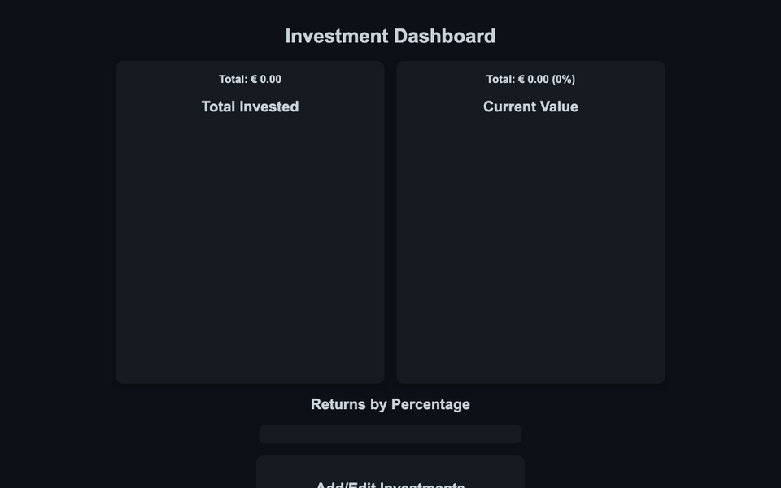

# Investments Dashboard 📈

Track a portfolio in the browser: what you invested, what it is worth now, and the return of each investment.

**Live demo:** https://mccprogrammer.github.io/investments-dashboard/



## Features

- Add, edit and remove investments
- Totals for amount invested and current value
- Charts of the portfolio and returns by percentage (Chart.js)
- Data saved in `localStorage`; no account, nothing leaves the browser

## Run it locally

No build step: clone the repo and open `index.html` in a browser.

```bash
git clone https://github.com/MCCProgrammer/investments-dashboard.git
open investments-dashboard/index.html
```

## Built with

HTML, CSS, plain JavaScript and [Chart.js](https://www.chartjs.org/).

---

One of my first web projects. More of my work at [mccprogrammer.com/projects](https://mccprogrammer.com/projects).
